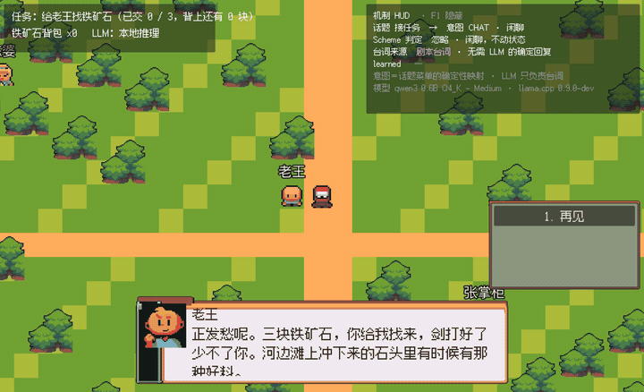

# llama.cpp-scheme

Scheme bindings for [llama.cpp](https://github.com/ggml-org/llama.cpp), built on [dummyscheme](https://github.com/zhuzhonghua/dummyscheme) — a small, embeddable Scheme VM.

The project produces a host executable, `scmllama`, that loads GGUF models and runs local LLM inference directly from Scheme scripts: tokenization, decoding, sampling, and text generation, with full lifecycle control over handles (model / context / batch / sampler). Errors surface as readable Scheme errors instead of process crashes.

## Quickstart

```scheme
(define m    (llm-model-load "models/Qwen3-0.6B-Q4_K_M.gguf"))
(define ctx  (llm-context-new m '((n-ctx . 1024))))
(define smpl (llm-sampler-new m '((temp . 0.7))))

(llm-chat-generate ctx smpl
  '(("system" . "You are a village blacksmith. Answer in one short sentence.")
    ("user"   . "Do you have a sword for me? /no_think"))
  (lambda (piece) (display piece) #t))
```

That is the whole idea: a model, a context, a sampler, and a generation that
streams tokens into a Scheme procedure. `./build/scmllama test/quickstart.scm`
runs exactly this file. Nothing is sent off-process.

Qwen3 opens with a reasoning block; `strip-think` in `test/npc-demo.scm` shows
one way to drop it.



## Demo: The Ford

A playable pixel village built on this library — [zhuzhonghua/theford](https://github.com/zhuzhonghua/theford). Every NPC line is written by Qwen3-0.6B running locally through `scmllama`; the quest state machine is plain Scheme.

The rule is **the LLM proposes, Scheme decides**. Player input is classified into an intent, a Scheme state machine checks it against the inventory and the quest stage, and only then does the model write the line. In the clip above the player tries to hand in ore they are not carrying: Scheme rejects the transition, and the refusal line is scripted rather than generated. `F1` opens a HUD with the whole chain — intent, verdict, line source, prefill/decode speed.

Generation streams from a worker thread while Godot keeps rendering. No HTTP server, no second process.

The same mechanism runs without a game engine, in a terminal:

```bash
./build/scmllama test/npc-demo.scm     # needs models/Qwen3-0.6B-Q4_K_M.gguf
```

## Build & Run

Verified on macOS arm64 (Metal + Accelerate enabled automatically). Linux is untested but uses the same CMake path; Windows is untested.

```bash
git clone --depth=1 https://github.com/zhuzhonghua/llama.cpp-scheme.git
cd llama.cpp-scheme
git submodule update --init --recursive   # llama.cpp + dummyscheme
./download-model.sh                       # Qwen3-0.6B Q4_K_M (~380 MB); pass "tiny" for the 1 MB smoke model
./build.sh                                # cmake configure + build, output in build/

./build/scmllama test/hello.scm
./build/scmllama test/quickstart.scm  # one chat turn, needs models/Qwen3-0.6B-Q4_K_M.gguf
./build/scmllama test/multiseq.scm        # two sequences generated in one decode
./build/scmllama test/npc-demo.scm        # interactive NPC + quest state machine
```

`test/npc-demo.scm` prints English by default; set `*lang*` to `'zh` at the top of the file for Chinese (the prompts switch with it).

`./build.sh Debug`, `./build.sh Release --clean`, and extra CMake flags are accepted. If huggingface.co is unreachable, `download-model.sh` falls back to hf-mirror.com; set `https_proxy` to route the download through a proxy.

## API

All functions are registered as native Scheme procedures (prefix `llm-`). Optional parameters are passed as an alist, e.g. `(llm-model-load "model.gguf" '(n-gpu-layers . 99))`.

### General

| Function | Description |
| --- | --- |
| `(llm-version)` | llama.cpp version string |
| `(llm-system-info)` | Build / system information |
| `(llm-quiet! bool)` | Toggle llama.cpp / ggml logging at runtime; it is already off from startup, `#f` only re-enables logs emitted after the call |

### Model

| Function | Description |
| --- | --- |
| `(llm-model-load path [options...])` | Load a GGUF model from file |
| `(llm-model-free model)` | Release a model |
| `(llm-model? obj)` | Type predicate |
| `(llm-model-info model)` | Model metadata as a hash-table (size, layers, vocab, tokens, chat template, ...) |
| `(llm-model-meta model)` | Raw GGUF metadata as a `key -> string` hash-table (scalar keys only) |

`llm-model-meta` returns the scalar GGUF key/value pairs llama.cpp keeps in
memory: strings verbatim, numbers and booleans as text. Array metadata
(tokenizer tables and similar) is omitted by llama.cpp and therefore absent.
Iterate with `(hash-table->alist meta)` or look up a key with
`(hash-table-ref meta "general.architecture")`.

### Vocab / Tokenization

| Function | Description |
| --- | --- |
| `(llm-tokenize model text [options...])` | Text → tokens |
| `(llm-detokenize model tokens [options...])` | Tokens → text |
| `(llm-token-to-piece model token)` | Token → raw piece string |
| `(llm-eog? model token)` | End-of-generation token check |

### Context

| Function | Description |
| --- | --- |
| `(llm-context-new model [options...])` | Create an inference context |
| `(llm-context-free ctx)` | Release a context |
| `(llm-context? obj)` | Type predicate |
| `(llm-context-info ctx)` | Hash-table: `n-ctx`, `n-batch`, `n-seq-max`, `n-threads`, `n-threads-batch`, `pooling-type` (`none`/`mean`/`cls`/`last`/`rank`) |
| `(llm-set-threads ctx n [n-batch])` | Change thread counts on a live context; batch count defaults to current |
| `(llm-reset ctx)` | Clear the KV cache / memory |

### KV cache

Generation keeps its cache in the context. These calls let a script continue a
conversation instead of re-prefilling it, or throw away part of it
deliberately. Positions are in tokens.

| Function | Description |
| --- | --- |
| `(llm-kv-pos ctx [seq])` | Tokens currently cached for the sequence (0 when empty) |
| `(llm-kv-remove ctx p0 p1)` | Drop cached cells in `[p0, p1)`; `p1 = -1` truncates the tail. A middle range leaves a hole — prefer truncating |
| `(llm-kv-shift ctx p0 p1 delta)` | Add `delta` to positions in `[p0, p1)`, e.g. close a front hole with `(llm-kv-shift ctx 0 -1 -n)` |
| `(llm-kv-copy ctx src dst [p0 p1])` | Copy a cached prefix from `src` into `dst` (beam expand / fork) |
| `(llm-kv-keep ctx seq)` | Keep only `seq`, drop the others (beam prune) |

`llm-generate` and `llm-chat-generate` accept `(keep-kv . #t)` to append at
`llm-kv-pos` instead of starting at 0. `llm-chat-generate` refuses it on
purpose: every call re-renders the whole message list, so appending would
duplicate history.

One caveat worth knowing: `llm-kv-shift` is `llama_memory_seq_add`, which
rewrites position metadata and does **not** recompute cached keys. A shifted
context is an approximation that degrades with distance; if that matters,
clear and rebuild from the turns you still want.

### Perf and session state

| Function | Description |
| --- | --- |
| `(llm-perf ctx)` | Hash-table of counters since the last reset: `n-prefill`, `n-decode`, `t-prefill-ms`, `t-decode-ms`, `t-load-ms`, `prefill-tps`, `decode-tps` |
| `(llm-perf-reset ctx)` | Zero the counters |
| `(llm-state-save ctx path)` | Write the KV cache and logits to a session file; token history stays in Scheme |
| `(llm-state-load ctx path)` | Restore a session file into a context |

### Batch / Decode

| Function | Description |
| --- | --- |
| `(llm-batch-from-tokens tokens [options...])` | Build a batch from a token list (sequence 0, positions `0..n-1`) |
| `(llm-batch-new capacity [options...])` | Create an empty batch; fill it token by token |
| `(llm-batch-add-token batch token pos [options...])` | Append a token at a position; returns its batch row index |
| `(llm-batch-clear batch)` | Drop the tokens, keep the allocation |
| `(llm-batch-set-logits batch index)` | Mark a position to produce logits |
| `(llm-batch-n-tokens batch)` | Number of tokens in the batch |
| `(llm-batch-free batch)` | Release a batch |
| `(llm-batch? obj)` | Type predicate |
| `(llm-decode ctx batch)` | Run the forward pass |

`llm-batch-from-tokens` covers the single-sequence case. For several
sequences, create the batch yourself and give every token a sequence and a
position; `llm-batch-new` takes `(n-seq-max . N)` for the number of sequence
ids a single token may carry, and `llm-batch-add-token` accepts `seq-id`
(default `0`), `seq-ids` (a list, to share one token between sequences) and
`logits` (default `#f`):

```scheme
(define ctx (llm-context-new m '((n-ctx . 1024) (n-seq-max . 2))))

;; one token per sequence, sampled from a single decode
(define batch (llm-batch-new 2 '((n-seq-max . 2))))
(llm-batch-add-token batch token-a 12 '((seq-id . 0) (logits . #t)))  ; -> 0
(llm-batch-add-token batch token-b 7  '((seq-id . 1) (logits . #t)))  ; -> 1
(llm-decode ctx batch)

(llm-sampler-sample smpl-a ctx 0)   ; row 0 = sequence 0
(llm-sampler-sample smpl-b ctx 1)   ; row 1 = sequence 1
```

Prefilling works the same way, one `llm-batch-add-token` per prompt token with
its sequence id and position; mark only the token you want to sample from with
`(logits . #t)`.

Keep positions consecutive within a sequence: the KV cache is append-only and
llama.cpp rejects a decode that reuses an occupied position. `llm-decode`
validates the batch first and reports empty batches, tokens without a sequence,
sequence ids beyond the context's `n-seq-max`, and negative positions as Scheme
errors instead of aborting.

Unless the context is created with `(kv-unified . #t)`, `n-ctx` is divided
evenly between the sequences: `(n-ctx . 1024)` with `(n-seq-max . 2)` leaves
512 tokens per sequence. A unified cache shares the whole `n-ctx` and lets one
token belong to several sequences via `seq-ids`.

`test/multiseq.scm` is a complete example: it prefills two prompts in one batch,
prints both generations advancing side by side, then repeats the same steps
with a single sequence (`./build/scmllama test/multiseq.scm`).

### Sampling

| Function | Description |
| --- | --- |
| `(llm-sampler-new model [options...])` | Create a sampler chain (grammar → penalties → top-k → top-p → min-p → temp → greedy/dist) |
| `(llm-sampler-sample sampler ctx [row])` | Sample a token from the last decoded logits, or from an explicit batch row |
| `(llm-sampler-reset sampler)` | Clear sampler state (grammar progress, penalty history, RNG stream) |
| `(llm-sampler-free sampler)` | Release a sampler |
| `(llm-sampler? obj)` | Type predicate |

Constrain generation with a [GBNF grammar](https://github.com/ggml-org/llama.cpp/blob/master/grammars/README.md):

```scheme
(define smpl
  (llm-sampler-new m
    '((greedy . #t)
      (grammar . "root ::= \"yes\" | \"no\""))))

(llm-generate ctx smpl "Answer yes or no: is the sky blue?" (lambda (p) #t))
;; => "yes" or "no", nothing else
```

`grammar-root` (default `"root"`) selects the start symbol. A grammar sampler keeps a pointer to the model vocabulary, so keep the model alive while the sampler is in use.

A sampler carries state across tokens, not just across calls. Reusing one for a
new prompt without `llm-sampler-reset` means the grammar parser is already in
its final state (generation stops immediately) and penalties still see the old
tokens. Reset also restarts the RNG stream, so a seeded sampler repeats its
sequence after a reset:

```scheme
(llm-generate ctx smpl prompt (lambda (p) #t))
(llm-reset ctx)
(llm-sampler-reset smpl)          ; required before the next prompt
(llm-generate ctx smpl prompt2 (lambda (p) #t))
```

### Generation

| Function | Description |
| --- | --- |
| `(llm-generate ctx sampler prompt callback [options...])` | Synchronous generation loop; returns generated text, calls `callback` per token piece, stops on EOG or `max-tokens` |
| `(llm-chat-generate ctx sampler messages callback [options...])` | Render `((role . content) ...)` with the model's chat template, then generate in one call |

### Chat templates

| Function | Description |
| --- | --- |
| `(llm-chat-template-apply model messages [options...])` | Render `((role . content) ...)` messages into a prompt with the model's chat template (or an explicit one) |
| `(llm-chat-templates)` | Vector of template names understood by llama.cpp (`chatml`, `llama3`, `gemma`, ...) |

```scheme
(llm-chat-template-apply m
  '(("system" . "You are a helpful assistant.")
    ("user" . "Hello!")))
;; => "<|im_start|>system\n...<|im_end|>\n<|im_start|>user\nHello!<|im_end|>\n<|im_start|>assistant\n"

;; Options: (template . "chatml") picks a built-in name or template source;
;; (add-assistant . #f) stops after the last message instead of opening an
;; assistant turn.
```

### Chat generation

`llm-chat-generate` renders the messages and runs the generation loop in one
call:

```scheme
(llm-chat-generate ctx smpl
  '(("system" . "You are a helpful assistant.")
    ("user" . "Hello!"))
  (lambda (piece) (display piece)))
```

Options:

| Option | Default | Description |
| --- | --- | --- |
| `template` | model's built-in | Template name or source (required when the model has none) |
| `add-assistant` | `#t` | Append the assistant turn header |
| `max-tokens` | `256` | Stop after this many tokens |
| `add-special` | `#f` | Prepend BOS; rendered templates already contain their markers |
| `parse-special` | `#t` | Parse `<|im_start|>`-style markers as special tokens |

The KV cache is cleared before each call, so one context can be reused across
conversations. `keep-kv` is rejected because the full conversation is
re-rendered every time; for incremental turns, use
`llm-chat-template-apply` + `llm-generate` with `(keep-kv . #t)`.

### Embeddings

| Function | Description |
| --- | --- |
| `(llm-embed ctx text [options...])` | Embed `text` and return a vector of floats |

The context must be created with `(embeddings . #t)`:

```scheme
(define ctx (llm-context-new m '((n-ctx . 512)
                                 (embeddings . #t)
                                 (pooling-type . mean))))

(llm-embed ctx "Once upon a time")
;; => #(0.0123 -0.0456 ...)
```

Options:

| Option | Default | Description |
| --- | --- | --- |
| `add-special` | `#t` | Prepend BOS when tokenizing |
| `parse-special` | `#f` | Treat special token markers as tokens |

`pooling-type` (on `llm-context-new`) accepts `none`, `mean`, `cls`, `last`, or `rank` (symbol or string). With `none` the result is the last token's embedding; with a pooled type it is one vector per sequence; `rank` uses the classifier dimension. The KV cache is cleared before every call, so use a dedicated context for embeddings.

### LoRA

| Function | Description |
| --- | --- |
| `(llm-lora-load model path)` | Load a GGUF LoRA adapter for `model` |
| `(llm-set-loras ctx loras)` | Set the adapters on a context, with optional per-adapter scales |
| `(llm-lora-free lora)` | Release an adapter early (also released with its model) |
| `(llm-lora? obj)` | Type predicate |

```scheme
(define style (llm-lora-load m "models/style.gguf"))
(llm-set-loras ctx (list (cons style 0.8)))   ; or (list style) for scale 1.0
;; ... generate ...
(llm-set-loras ctx '())                       ; remove all adapters
```

An adapter belongs to the model it was loaded for. `llm-model-free` releases
the model's adapters automatically; free adapters first if you want the memory
back earlier. LoRA files must match the base model architecture and tensors.


## License

See [LICENSE](LICENSE).
