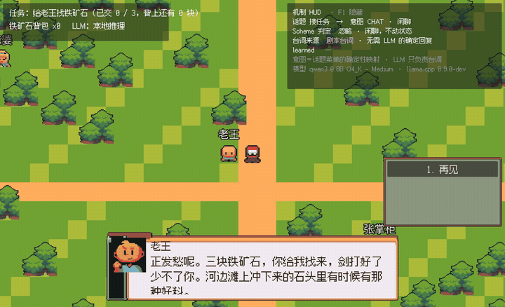

# llama.cpp-scheme

Scheme bindings for [llama.cpp](https://github.com/ggml-org/llama.cpp), built on [dummyscheme](https://github.com/zhuzhonghua/dummyscheme) — a small, embeddable Scheme VM.

The project produces a host executable, `scmllama`, that loads GGUF models and runs local LLM inference directly from Scheme scripts: tokenization, decoding, sampling, and text generation, with full lifecycle control over handles (model / context / batch / sampler). Errors surface as readable Scheme errors instead of process crashes.



## Demo: The Ford

A playable pixel village built on this library — [zhuzhonghua/theford](https://github.com/zhuzhonghua/theford). Every NPC line is written by Qwen3-0.6B running locally through `scmllama`; the quest state machine is plain Scheme.

The rule is **the LLM proposes, Scheme decides**. Player input is classified into an intent, a Scheme state machine checks it against the inventory and the quest stage, and only then does the model write the line. In the clip above the player tries to hand in ore they are not carrying: Scheme rejects the transition, and the refusal line is scripted rather than generated. `F1` opens a HUD with the whole chain — intent, verdict, line source, prefill/decode speed.

Generation streams from a worker thread while Godot keeps rendering. No HTTP server, no second process.

The same mechanism runs without a game engine, in a terminal:

```bash
./build/scmllama test/npc-demo.scm     # needs models/Qwen3-0.6B-Q4_K_M.gguf
```

## Build & Run

Verified on macOS arm64 (Metal + Accelerate enabled automatically). Linux is untested but uses the same CMake path; Windows is untested.

```bash
git clone --depth=1 https://github.com/zhuzhonghua/llama.cpp-scheme.git
cd llama.cpp-scheme
git submodule update --init --recursive   # llama.cpp + dummyscheme
./download-model.sh                       # Qwen3-0.6B Q4_K_M (~380 MB); pass "tiny" for the 1 MB smoke model
./build.sh                                # cmake configure + build, output in build/

./build/scmllama test/hello.scm
./build/scmllama test/npc-demo.scm        # interactive NPC + quest state machine
```

`./build.sh Debug`, `./build.sh Release --clean`, and extra CMake flags are accepted. If huggingface.co is unreachable, `download-model.sh` falls back to hf-mirror.com; set `https_proxy` to route the download through a proxy.

## API

All functions are registered as native Scheme procedures (prefix `llm-`). Optional parameters are passed as an alist, e.g. `(llm-model-load "model.gguf" '(n-gpu-layers . 99))`.

### General

| Function | Description |
| --- | --- |
| `(llm-version)` | llama.cpp version string |
| `(llm-system-info)` | Build / system information |
| `(llm-quiet! bool)` | Silence llama.cpp and ggml logging |

### Model

| Function | Description |
| --- | --- |
| `(llm-model-load path [options...])` | Load a GGUF model from file |
| `(llm-model-free model)` | Release a model |
| `(llm-model? obj)` | Type predicate |
| `(llm-model-info model)` | Model metadata as a hash-table (size, layers, vocab, tokens, chat template, ...) |

### Vocab / Tokenization

| Function | Description |
| --- | --- |
| `(llm-tokenize model text [options...])` | Text → tokens |
| `(llm-detokenize model tokens [options...])` | Tokens → text |
| `(llm-token-to-piece model token)` | Token → raw piece string |
| `(llm-eog? model token)` | End-of-generation token check |

### Context

| Function | Description |
| --- | --- |
| `(llm-context-new model [options...])` | Create an inference context |
| `(llm-context-free ctx)` | Release a context |
| `(llm-context? obj)` | Type predicate |
| `(llm-context-info ctx)` | Context info |
| `(llm-reset ctx)` | Clear the KV cache / memory |

### Batch / Decode

| Function | Description |
| --- | --- |
| `(llm-batch-from-tokens tokens [options...])` | Build a batch from a token list |
| `(llm-batch-set-logits batch index)` | Mark a position to produce logits |
| `(llm-batch-n-tokens batch)` | Number of tokens in the batch |
| `(llm-batch-free batch)` | Release a batch |
| `(llm-batch? obj)` | Type predicate |
| `(llm-decode ctx batch)` | Run the forward pass |

### Sampling

| Function | Description |
| --- | --- |
| `(llm-sampler-new model [options...])` | Create a sampler chain (penalties → top-k → top-p → min-p → temp → greedy/dist) |
| `(llm-sampler-sample sampler ctx)` | Sample the next token from logits |
| `(llm-sampler-free sampler)` | Release a sampler |
| `(llm-sampler? obj)` | Type predicate |

### Generation

| Function | Description |
| --- | --- |
| `(llm-generate ctx sampler prompt callback [options...])` | Synchronous generation loop; returns generated text, calls `callback` per token piece, stops on EOG or `max-tokens` |

## License

See [LICENSE](LICENSE).
